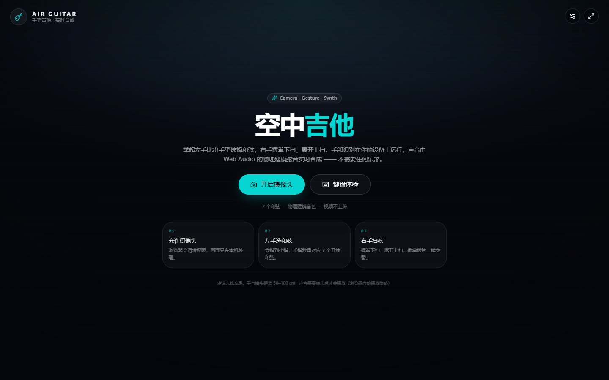
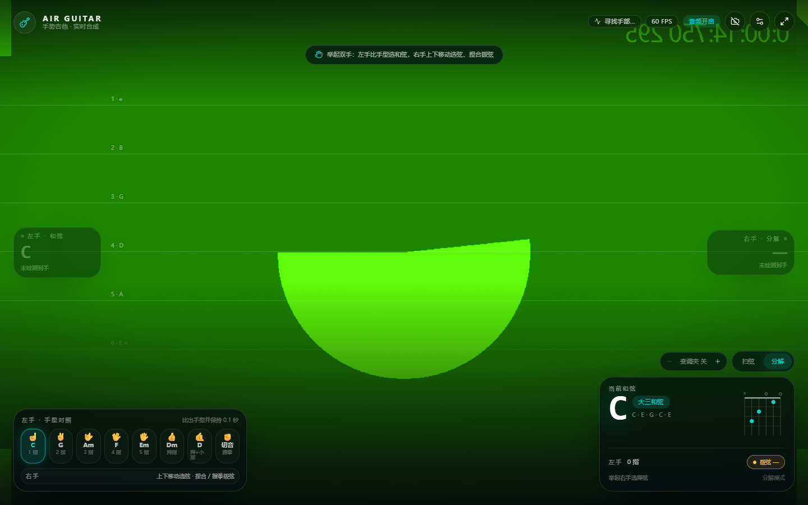
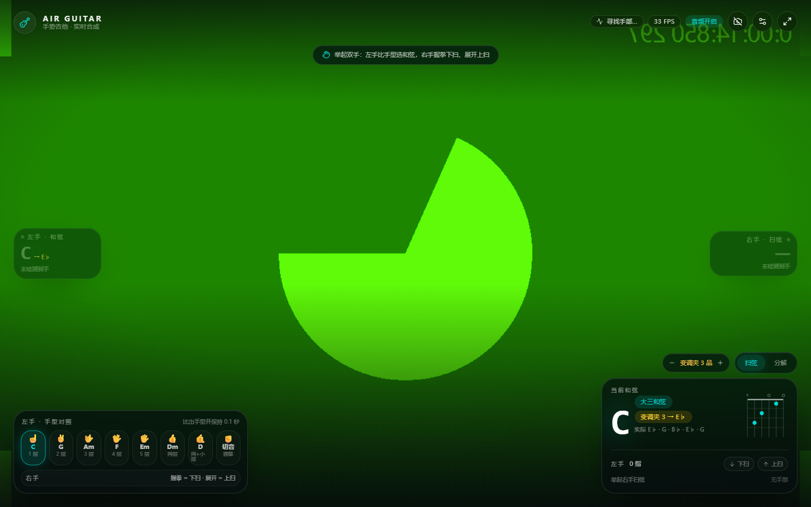

# 空中吉他 · Air Guitar

用摄像头做一把不用碰的吉他：**左手比出手型选择和弦，右手握拳下扫 / 展开上扫，或切到分解指弹，声音由 Web Audio 物理建模实时合成**。摄像头画面全屏镜像显示，手部骨架、和弦标签、弦位轨道与扫弦反馈直接叠在画面上。

- 手部识别：[MediaPipe Hand Landmarker]（模型与 WASM 全部本地托管，不上传任何画面）
- 演奏方式：**扫弦** 与 **分解和弦**（右手选弦 + 捏合拨弦 / 自动指型伴奏）
- 变调夹：0–7 品整体移调，指型不变，实际和弦与音高一起变
- 左右侧固定读数：左手和弦在左、右手手势在右，垂直居中，不跟随手部移动
- 手感可调：手型确认/扫弦间隔、抓取/捏合灵敏度、和弦保持时间都能在设置里实时滑调，并自动记住
- 音色：Karplus-Strong 拨弦物理建模 + 琴身 EQ + 合成房间混响（不加载任何音频文件）
- 界面：React 19 + Vite + Tailwind CSS v4 + shadcn/ui 风格组件（Radix 原语）

## 快速开始

```bash
npm install      # 安装依赖
npm run dev      # 启动开发服务器（会先准备 wasm 与手部模型）
npm run build    # 类型检查 + 生产构建
npm run preview  # 预览构建产物
```

打开终端输出的地址（默认 http://localhost:5173），点击「开启摄像头」并允许权限。

> 摄像头只在 `https` 或 `localhost` 下可用；画面不离开本机。声音必须在一次点击之后才能播放（浏览器自动播放策略）。

### 资源准备

`npm run dev` / `npm run build` 会自动执行 `scripts/prepare-assets.mjs`：

1. 把 `@mediapipe/tasks-vision` 的 SIMD / 非 SIMD WASM 运行时复制到 `public/mediapipe/wasm/`（约 26 MB）；
2. 下载手部关键点模型到 `public/models/hand_landmarker.task`（约 7.5 MB，仅首次）。

脚本可重复执行；模型下载失败时不会中断构建，页面会给出提示并允许重试（此时会回退到 CDN）。

## 在线部署（GitHub Pages）

推送到 [lerte/guitar](https://github.com/lerte/guitar) 后由 GitHub Actions 自动构建并发布，不需要手动上传 `dist/`：

- 站点地址：https://lerte.github.io/guitar/
- 工作流：`.github/workflows/deploy.yml`（推送到 `main` 时触发，也可在 Actions 页手动 `Run workflow`）
- `vite.config.ts` 根据 `GITHUB_REPOSITORY` 自动把 `base` 设为 `/guitar/`，本地开发仍是 `/`；运行时资源路径统一走 `import.meta.env.BASE_URL`，所以子路径部署不会 404
- 首次运行会由 `actions/configure-pages` 自动开启 Pages；若仓库策略阻止，手动到 **Settings → Pages → Source** 选择 **GitHub Actions** 即可

> `public/mediapipe/` 与 `public/models/` 下的 WASM 与模型随仓库提交，构建时无需联网下载，Pages 站点完全自托管。

## 预览

| 起始页 | 分解模式 | 变调夹 |
| --- | --- | --- |
|  |  |  |

试听当前合成音色（约 4.5 秒：C → G → Am 扫弦、D 分解、Em 扫弦）：[strum-demo.webm](docs/audio/strum-demo.webm)

## 手势对照

左手（选择和弦，手型保持约 0.1 秒才生效）：

| 手型 | 和弦 | 说明 |
| --- | --- | --- |
| ☝️ 食指 | C | 1 指 |
| ✌️ 食指 + 中指 | G | 2 指 |
| 🤟 三指 | Am | 食指 + 中指 + 无名指 |
| 🖖 四指 | F | 食指到小指 |
| 🖐️ 五指张开 | Em | 全开 |
| 👍 只竖拇指 | Dm | 拇指 |
| 🤙 拇指 + 小指 | D | 摇滚手势 |
| ✊ 握拳 | 切音 | 闷音 / 停止发声 |

无法精确匹配时按“伸出手指的数量”回退映射（0→切音、1→C、2→G、3→Am、4→F、5→Em），所以拇指识别不确定时也能弹。

## 两种右手演奏方式

右下角切换「扫弦 / 分解」，「`V`」键也可以快速切换。

### 扫弦

右手只有两种手型，像拿拨片一样交替：

- **握拳（抓取）→ 下扫**；**张开（展开）→ 上扫**；
- 手型不动就一直不出声，所以不可能连续同向扫弦；要再扫一次，必须先换成另一个手型；
- 手型需要稳定 60 ms 才计一次（设置里可调），手抖不会误触；
- 力度来自挥动速度：挥得越快越响。

### 分解和弦（指弹）

切到「分解」后画面会出现 6 条弦位轨道（1 弦高音 e 在顶部，6 弦低音 E 在底部）：

- 右手**上下移动**选弦，高亮轨道就是当前要拨的弦；
- **捏合（拇指 + 食指）或握拳**拨响当前弦；保持捏合上下移动，跨过几条弦就依次拨响几条 —— 手动就能弹出 53231323；
- 高亮弦旁标 `×` 表示当前和弦不弹这根弦（例如 D 和弦的 5、6 弦），拨它不发声，和真吉他一致；
- 拨弦力度同样来自移动速度。

### 自动分解（伴奏）

设置面板里打开「自动分解和弦」，选择指型（`53231323` / `63231323` / `532313` / `5-3-2-3`）并调节速度（50–160 BPM，八分音符）。它会跟随左手和弦循环拨弦，换和弦即时生效，切音时暂停。`A` 键也能开关。

## 变调夹

右下角「变调夹 −/+」可以夹 0–7 品（`-` / `=` 键也能调）：

- 手型不用改：夹 3 品弹 C 指型，响的是 E♭ 和弦；
- 和弦卡同时显示**指型**（大字 + 指板图）和**实际发声**（`变调夹 3 → E♭`，音符行变成 `实际 E♭ · G · B♭ …`）；
- 扫弦、单弦分解、自动分解都按变调夹后的音高发声 —— 引擎里每根弦统一升高 N 个半音，移调后的弦音缓冲会提前预热，切换时没有卡顿。

## 手感调参（设置面板）

设置 →「手感阈值 · 实时生效」，5 个滑杆直接改判定参数，拖动的下一帧就生效，并写入 `localStorage`（`air-guitar:feel`），下次打开自动恢复：

| 滑杆 | 影响 | 默认 |
| --- | --- | --- |
| 手型确认 | 握拳 / 展开要稳定多久才算一次扫弦（0–200 ms） | 60 ms |
| 扫弦间隔 | 两次扫弦之间最短的间隔（40–300 ms） | 95 ms |
| 抓取阈值 | 握拳判定，越大越难握拳（0.30–0.85） | 0.58 |
| 捏合阈值 | 拨弦捏合判定，越小越容易捏合（0.15–0.75） | 0.45 |
| 和弦保持 | 手型要稳定多久才切换和弦（40–400 ms） | 110 ms |

「恢复默认」一键还原。迟滞的另一半自动跟随：抓取释放 = 阈值 −0.22，捏合释放 = 阈值 +0.27，切音保持 = 和弦保持 ×0.64。

## 键盘与快捷键

| 按键 | 功能 |
| --- | --- |
| `1`–`7` | 选择 C / G / Am / F / Em / D / Dm |
| `空格` / `↓` | 下扫 |
| `↑` | 上扫 |
| `V` | 切换扫弦 / 分解 |
| `-` / `=` | 变调夹降 / 升一品 |
| `A` | 开 / 关自动分解 |
| `[` / `]` | 自动分解速度 −/+ |
| `M` | 切音 |
| `F` | 全屏 |
| `H` | 显示/隐藏手型对照卡 |
| `S` | 显示/隐藏手部骨架 |

「键盘体验」按钮可以不起摄像头直接试听音色（适合没有摄像头的环境）。

## URL 参数

- `?autostart=1` 自动开始（截图/录制演示用；音频仍需要一次点击解锁）
- `?mode=pick` 直接进入分解模式
- `?capo=3` 启动时夹 3 品（0–7）
- `?arp=1` 启动时开启自动分解
- `?swap=1` 打开左右手互换（默认关闭）

## 实现要点

```
src/
  App.tsx                     页面编排：启动流程、HUD、快捷键、自动分解调度、音频/视频生命周期
  hooks/use-hand-tracking.ts  rAF 循环：推理 → 手势状态机 → 音频回调 + 画布叠加层
  lib/hands/
    hand-tracker.ts           MediaPipe HandLandmarker 封装（GPU→CPU 回退、单例加载）
    landmarks.ts              21 个关键点 → 手指伸直 / 抓取 / 捏合特征（尺度归一化）
    gesture-controller.ts     时间去抖：和弦切换、抓取迟滞、扫弦方向、右手选弦与拨弦
    overlay.ts                Canvas 骨架、掌心环、标签、扫弦脉冲、6 条弦位轨道
  lib/guitar/
    chords.ts                 标准调弦、7 个开放和弦、手势→和弦映射、弦位工具
    audio-engine.ts           Karplus-Strong 合成器、单弦拨奏、变调夹移调、琴身 EQ、混响
    arpeggio.ts               分解指型 + 前瞻调度的自动分解播放器
  components/hud/             顶栏、和弦卡、手型对照、演奏方式开关、设置面板
  components/ui/              shadcn 风格基础组件（Button/Badge/Slider/Switch/Tooltip…）
```

**识别**：MediaPipe 输出 21 个归一化关键点。识别结果不再跟着手画标签：画布只保留骨架、掌心环、弦位轨道与动效，真正的读数由 React 固定在左右两侧垂直居中显示（左手 · 和弦 / 右手 · 扫弦或分解），移动手部时文字不会乱跑。手指是否伸直用“首末点距离 / 折线长度”的直度比判断，并辅以“指尖离手腕比 PIP 更远”的约束；所有距离都除以“手腕→中指根”的尺度，因此远近、旋转、倾斜都稳定。抓取要求四个手指全部收拢，再结合指尖是否贴向掌心，避免把单指/两指手势误判成握拳。

**时序**：原始帧抖动很大，所以和弦需要稳定 110 ms 才切换（切音 70 ms），抓取用 0.58/0.36 双阈值迟滞。扫弦直接由手型决定方向：握拳 = 下扫、展开 = 上扫；手型要稳定 60 ms 才计入，两个事件之间还有 95 ms 最短间隔，因此同一动作不会连发同向扫弦，方向天然交替。

**分解**：右手高度映射到 6 段弦位（`STRING_BAND`），捏合用“拇指尖—食指尖距离 ÷ 手尺度”判断，与握拳共用一个迟滞开关（0.45 进入 / 0.72 退出，且握拳也视为捏合）；边界处有 16% 死区，跨弦补拨有 45 ms 去抖，避免手停在分界线时连击。

**音色**：每个音高离线渲染成一段 Karplus-Strong 弦振动。激励不是随机噪声，而是「拨弦三角形」—— 按拨弦位置取形的初始位移：噪声激励会让每根弦的谐波比例随机、基频常常比邻近谐波还弱（实测基频能量只有二次谐波的 1/10），听起来空洞发飘；三角形给出真实的 1/n² 弦谱和拨弦位置梳状零点，再混入少量滤波噪声做拨片质感。按整数周期渲染后通过 `playbackRate` 精确校音高，低音 t60≈4.5 s、高音≈2.6 s。

信号链：六根弦独立声像与微失谐 → 琴身四点 EQ（105 Hz 亥姆霍兹共鸣、210 Hz 木体、520 Hz 去箱音、2.4 kHz 存在感）→ 7.2 kHz 低通切掉毛刺 → 温和压缩（-10 dB / 2.2:1，慢启动保留拨弦瞬态）→ 变暗的合成房间混响（尾音随时间变暗，不再是一层亮噪声）。扫弦按 10/8 ms 逐弦触发，拨弦单弦发声，缓冲按音高缓存。

**自动分解**：25 ms 定时器做 120 ms 前瞻调度，把八分音符直接排到 AudioContext 时间轴上，不受 `setInterval` 抖动影响；遇到和弦不发声的弦会自动落到最近的可弹弦（D 和弦的低音落到 4 弦），保证低音不空。

**变调夹**：不做“换一套和弦”，而是在发声层统一加 N 个半音（`TUNING_MIDI + fret + capo`），所以指型、录音、扫弦顺序全部不变；显示层用扁平音名推导实际和弦（C + 3 → E♭），并同步把和弦卡的音名列换成实际发声的音。

**手感阈值**：控制器只从 `feel.ts` 的数据对象读参数（`setTuning()` 每帧调用，传入对象引用不变时直接返回），所以滑杆拖动不需要重建控制器；滑杆只给单一数值，迟滞的另一侧由控制器派生，避免“两个阈值打架”。

## 可调参数

- 手感阈值（可实时调）：`src/lib/hands/feel.ts` 的 `DEFAULT_FEEL` 与 `FEEL_RANGES`
- 固定阈值：`src/lib/hands/landmarks.ts`（直度、抓取/捏合归一化）、`src/lib/hands/gesture-controller.ts`（`STRING_BAND`、拨弦间隔、扫弦静默期）
- 和弦与手型映射：`src/lib/guitar/chords.ts` 的 `SHAPES` 与 `PATTERN_TO_CHORD`
- 变调夹范围：`src/lib/guitar/chords.ts` 的 `CAPO_RANGE`（默认 7 品）
- 分解指型：`src/lib/guitar/arpeggio.ts` 的 `ARPEGGIO_PATTERNS`
- 音色：`src/lib/guitar/audio-engine.ts` 的 T60、`STRING_PAN`/`STRING_DETUNE_CENTS`、EQ 与混响参数

## 已知限制

- 左右手判定依赖 MediaPipe 的 handedness，默认直接采用模型输出；若你的环境识别相反，在设置里打开「左右手互换」即可（也可用 `?swap=1` 启动）。
- 需要现代浏览器（Chrome/Edge 113+、Safari 17+）；GPU 不可用时自动回退 CPU，帧率会下降。
- 强逆光、手离镜头过远（>1.5 m）或手部大面积遮挡时识别会丢失；调整光线与距离即可。
- 分解模式依赖右手高度稳定：手抖可能扫到相邻弦，放慢移动或提高 `STRING_BAND` 的分段死区即可改善。
- 摄像头画面本身不会离开设备，但首次加载需要下载约 7.5 MB 的模型文件。

[MediaPipe Hand Landmarker]: https://ai.google.dev/edge/mediapipe/solutions/vision/hand_landmarker
